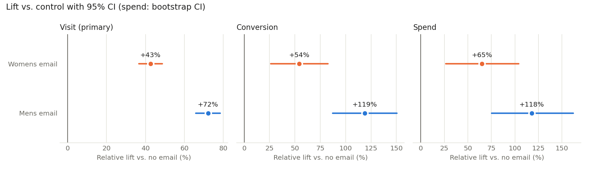

# Email A/B Test Analysis — MineThatData Hillstrom (2008)

A pre-registered analysis of a three-arm randomized email experiment, covering design, validity checks, effect estimation with multiplicity control, variance reduction, a single subgroup test, and an A/A validation of the pipeline.

**Bottom line:** both emails increased visits, conversions and spend versus no email, and all 6 pre-registered tests stay significant after Holm correction. The **Men's email** performs best, adding **$7,700 per 10,000 emails** (95% CI $4,900–$10,600) over two weeks.



## Data
Kevin Hillstrom's MineThatData E-Mail Analytics Challenge (blog.minethatdata.com, March 2008). It covers 64,000 customers who bought within the previous 12 months, randomized about 1/3 each to a **Mens E-Mail**, a **Womens E-Mail** or **No E-Mail**, with outcomes tracked for two weeks.

- **Treatment:** `segment`
- **Outcomes:** `visit`, `conversion`, `spend`
- **Pre-treatment covariates:** `recency`, `history`, `history_segment`, `mens`, `womens` (past purchase flags, *not* treatment), `newbie`, `zip_code`, `channel`

The CSV is in `data/hillstrom.csv`, downloaded from the [original URL](http://www.minethatdata.com/Kevin_Hillstrom_MineThatData_E-MailAnalytics_DataMiningChallenge_2008.03.20.csv). The `sklift.datasets.fetch_hillstrom(target_col='all')` loader serves the same file.

## Repository
```
docs/01_analysis_plan.md        pre-registered plan, written before outcomes were read
docs/02_recommendation_memo.md  one-page memo for a non-technical marketing lead
run_analysis.py                 the full pipeline (≈15 s)
src/stats.py                    tests, bootstrap, SMD, HC2 regression, Holm, Wilson CI
results/                        CSV tables, summary.json, run_log.txt
figures/lifts.png
```
Reproduce with `pip install -r requirements.txt && python run_analysis.py`.

## Methods
| Step | Method |
|---|---|
| Plan | Primary metric `visit` (most power); secondary `conversion` and `spend`. α = 0.05. Each email arm vs. control. Holm across all 6 tests. Planned MDE for visit at an assumed 10% baseline and n ≈ 21.3k per arm is **0.81 pp** (about 1.0 pp at the strictest Holm step). |
| SRM | χ² goodness-of-fit on arm counts against 1/3 each |
| Balance | Standardized mean differences against control for all covariates (threshold \|SMD\| < 0.1), plus an omnibus ANOVA/χ² per covariate |
| Binary outcomes | Two-proportion z-test (pooled SE for the test, unpooled SE for the CI) |
| Spend | Welch's t-test and t-CI, plus a 10,000-draw percentile bootstrap CI |
| Variance reduction | OLS `Y ~ treat + history + recency` with HC2 SEs against unadjusted `Y ~ treat`, reported as the equivalent sample-size gain (SE²_unadj / SE²_adj − 1). The all-covariate model is exploratory. |
| Subgroup | One pre-specified question: Mens email among women's-only buyers (`womens=1, mens=0`), with the interaction from `visit ~ treat * womens_only`. Hypothesis-generating. |
| A/A | Split the control arm in half 1,000 times and record the false-positive rate of the visit z-test and the spend Welch test |

## Results

### Validity
- **SRM:** 21,307 / 21,387 / 21,306, χ² = 0.20, **p = 0.90**. No sample-ratio mismatch.
- **Balance:** the largest |SMD| across 11 covariate columns × 2 arms is **0.014**, far below 0.1. The smallest omnibus p is 0.22. Randomization worked.
- **A/A:** the visit z-test rejected **4.8%** of the time (Wilson 95% CI 3.6–6.3%) and the spend Welch test **4.4%** (3.3–5.9%). Both sets of p-values look uniform (KS p = 0.16 and 0.33). The pipeline is calibrated.

### Main effects (each arm vs. no email)
| Arm | Metric | Control | Treated | Abs. lift [95% CI] | Rel. lift | p (Holm) |
|---|---|---|---|---|---|---|
| Mens | **visit** | 10.62% | 18.28% | **+7.66 pp** [6.99, 8.32] | +72% | 3e-111 |
| Mens | conversion | 0.573% | 1.253% | +0.68 pp [0.50, 0.86] | +119% | 6e-13 |
| Mens | spend | $0.653 | $1.423 | +$0.770 [0.485, 1.054] | +118% | 3e-7 |
| Womens | **visit** | 10.62% | 15.14% | **+4.52 pp** [3.89, 5.16] | +43% | 2e-43 |
| Womens | conversion | 0.573% | 0.884% | +0.31 pp [0.15, 0.47] | +54% | 3e-4 |
| Womens | spend | $0.653 | $1.077 | +$0.424 [0.169, 0.680] | +65% | 0.0011 |

All 6 tests remain significant after Holm. The visit effects are about 5.5× (Womens) and 9.5× (Mens) the planned MDE.

**Spend: t-CI vs. bootstrap.** Spend is 99.1% zeros, and among buyers it is right-skewed (skew 1.8). Even so, with n ≈ 21k per arm the sampling distribution of the difference in means is close to normal. The bootstrap distributions have skew 0.06 and 0.02, and the two CIs agree to within half a cent:

| Arm | Welch t-CI | Bootstrap CI | t-SE / boot-SE |
|---|---|---|---|
| Mens | [0.485, 1.054] | [0.490, 1.058] | 0.1452 / 0.1448 |
| Womens | [0.169, 0.680] | [0.173, 0.680] | 0.1303 / 0.1290 |

**Mens vs. Womens** (descriptive, outside the Holm family): visit +3.1 pp [2.4, 3.8], spend +$0.35 [0.03, 0.66], p = 0.03.

**Incremental revenue per 10,000 emails** (bootstrap 95% CI): Mens **$7,698** [$4,905, $10,580]; Womens **$4,244** [$1,729, $6,800].

### Variance reduction
| Arm | Metric | SE unadj. | SE adj. (history + recency) | Equiv. n gain | Equiv. n gain, all covariates |
|---|---|---|---|---|---|
| Mens | visit | 0.003386 | 0.003371 | **+0.9%** | +3.0% |
| Womens | visit | 0.003234 | 0.003222 | **+0.8%** | +2.7% |
| Mens | spend | 0.1453 | 0.1452 | +0.08% | +0.25% |
| Womens | spend | 0.1303 | 0.1302 | +0.16% | +0.16% |

The gain is small, and that is the honest finding. Regression adjustment helps in proportion to the outcome variance the covariates explain. Here `history` correlates with two-week visits at only r ≈ 0.07, and `recency` at r ≈ −0.08, so adjustment explains about 1–2% of the variance. Spend is dominated by rare, large purchases that no covariate predicts. True CUPED would need the *same metric* measured before the experiment, such as visits in the prior two weeks, which this dataset doesn't include. Point estimates barely move (Mens visit 0.0766 vs. 0.0766), which is consistent with good randomization.

### Subgroup: Mens email among women's-only buyers (hypothesis-generating)
Women's-only buyers make up 44.8% of the Mens + control sample (n = 19,087).
- Within the subgroup, visit rose from 9.58% to 16.64%, a lift of **+7.06 pp** [6.11, 8.01].
- Among everyone else it rose from 11.45% to 19.61%, a lift of +8.16 pp [7.24, 9.08].
- The interaction is **−1.1 pp** [−2.4, +0.2], **p = 0.10**.

The Men's email clearly works on women's-only buyers. There is a hint of a smaller effect in this group, but it is not significant, and the CI rules out anything more than a modest attenuation. This finding is hypothesis-generating: it was the only subgroup examined, and it covered visits only.

## Limitations
- **2008 data.** Email engagement, deliverability and inbox filtering are very different today. The effect sizes are unlikely to transfer directly.
- **Two-week window.** The data can't separate new demand from purchases pulled forward in time, and they don't capture longer-term effects such as unsubscribes, fatigue or list decay.
- **No cost or margin data.** "Incremental revenue" is gross revenue, not profit or ROI.
- **Single send, single creative per arm.** Effects belong to these specific emails, not to "men's" or "women's" email in general.
- **Spend relies on rare events.** Only about 0.9% of customers bought anything, so spend CIs are wide (about ±37% of the Mens point estimate).
- **One subgroup, one metric.** The subgroup result is hypothesis-generating. No other cuts were examined, and none should be read into these results.
- **Holm across all 6 tests is conservative** relative to a primary-only family. Since every test passes, the choice doesn't change any conclusion.
