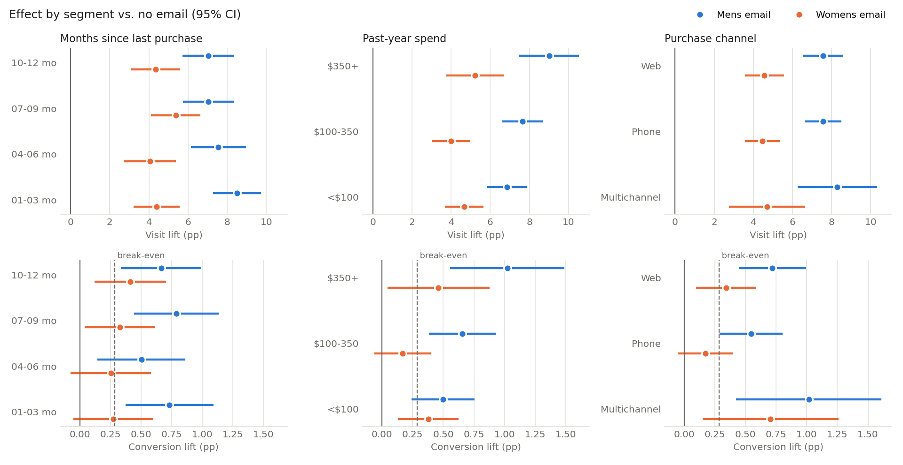

# Email A/B Test Analysis — MineThatData Hillstrom (2008)

A pre-registered analysis of a three-arm randomized email experiment, in two stages:

1. **Did the emails work?** Design, validity checks, effect estimation with multiplicity control, variance reduction, a single subgroup test, and an A/A validation of the pipeline.
2. **Who should get which email, and is targeting worth it?** Heterogeneous effects (segments and a T-learner), a cost-aware targeting decision evaluated out of sample, and all aggregation done in SQL (DuckDB).

**Bottom line:** both emails increased visits, conversions and spend versus no email, and all 6 pre-registered tests stay significant after Holm correction. The **Men's email** performs best, adding **$7,700 per 10,000 emails** (95% CI $4,900–$10,600) over two weeks. With a cost per email and a margin per conversion, **sending the Men's email to everyone beats every targeted policy we could learn**. Targeting by recency and spend loses $305 per 10,000 customers out of sample (95% CI −$597 to −$22), even though it appears to gain $80 when learned and evaluated on the same data.


## Data
Kevin Hillstrom's MineThatData E-Mail Analytics Challenge (blog.minethatdata.com, March 2008). It covers 64,000 customers who bought within the previous 12 months, randomized about 1/3 each to a **Mens E-Mail**, a **Womens E-Mail** or **No E-Mail**, with outcomes tracked for two weeks.

- **Treatment:** `segment`
- **Outcomes:** `visit`, `conversion`, `spend`
- **Pre-treatment covariates:** `recency`, `history`, `history_segment`, `mens`, `womens` (past purchase flags, *not* treatment), `newbie`, `zip_code`, `channel`

The CSV is in `data/hillstrom.csv`, downloaded from the [original URL](http://www.minethatdata.com/Kevin_Hillstrom_MineThatData_E-MailAnalytics_DataMiningChallenge_2008.03.20.csv). The `sklift.datasets.fetch_hillstrom(target_col='all')` loader serves the same file.

## Repository
```
docs/01_analysis_plan.md        pre-registered plan, written before outcomes were read
docs/02_recommendation_memo.md  one-page memo for a non-technical marketing lead
docs/03_stage2_plan.md          stage 2 plan (segments, economics, decision rule), written before segment results
run_analysis.py                 stage 1 pipeline (≈15 s)
run_hte.py                      stage 2: runs sql/*.sql in DuckDB, then T-learner + policy evaluation (≈35 s)
sql/                            all stage 2 aggregation: customers, arm/segment stats, lifts + SEs, CV cells
src/stats.py                    tests, bootstrap, SMD, HC2 regression, Holm, Wilson CI
results/                        stage 1 tables; results/hte/ holds stage 2 tables (sql_*.csv = raw SQL output)
figures/lifts.png, figures/segment_lifts.png
```
Reproduce with `pip install -r requirements.txt && python run_analysis.py && python run_hte.py`.

## Methods
| Step | Method |
|---|---|
| Plan | Primary metric `visit` (most power); secondary `conversion` and `spend`. α = 0.05. Each email arm vs. control. Holm across all 6 tests. Planned MDE for visit at an assumed 10% baseline and n ≈ 21.3k per arm is **0.81 pp** (about 1.0 pp at the strictest Holm step). |
| SRM | χ² goodness-of-fit on arm counts against 1/3 each |
| Balance | Standardized mean differences against control for all covariates (threshold \|SMD\| < 0.1), plus an omnibus ANOVA/χ² per covariate |
| Binary outcomes | Two-proportion z-test (pooled SE for the test, unpooled SE for the CI) |
| Spend | Welch's t-test and t-CI, plus a 10,000-draw percentile bootstrap CI |
| Variance reduction | OLS `Y ~ treat + history + recency` with HC2 SEs against unadjusted `Y ~ treat`, reported as the equivalent sample-size gain (SE²_unadj / SE²_adj − 1). The all-covariate model is exploratory. |
| Subgroup | One pre-specified question: Mens email among women's-only buyers (`womens=1, mens=0`), with the interaction from `visit ~ treat * womens_only`. Hypothesis-generating. |
| A/A | Split the control arm in half 1,000 times and record the false-positive rate of the visit z-test and the spend Welch test |

## Results

### Validity
- **SRM:** 21,307 / 21,387 / 21,306, χ² = 0.20, **p = 0.90**. No sample-ratio mismatch.
- **Balance:** the largest |SMD| across 11 covariate columns × 2 arms is **0.014**, far below 0.1. The smallest omnibus p is 0.22. Randomization worked.
- **A/A:** the visit z-test rejected **4.8%** of the time (Wilson 95% CI 3.6–6.3%) and the spend Welch test **4.4%** (3.3–5.9%). Both sets of p-values look uniform (KS p = 0.16 and 0.33). The pipeline is calibrated.

### Main effects (each arm vs. no email)
| Arm | Metric | Control | Treated | Abs. lift [95% CI] | Rel. lift | p (Holm) |
|---|---|---|---|---|---|---|
| Mens | **visit** | 10.62% | 18.28% | **+7.66 pp** [6.99, 8.32] | +72% | 3e-111 |
| Mens | conversion | 0.573% | 1.253% | +0.68 pp [0.50, 0.86] | +119% | 6e-13 |
| Mens | spend | $0.653 | $1.423 | +$0.770 [0.485, 1.054] | +118% | 3e-7 |
| Womens | **visit** | 10.62% | 15.14% | **+4.52 pp** [3.89, 5.16] | +43% | 2e-43 |
| Womens | conversion | 0.573% | 0.884% | +0.31 pp [0.15, 0.47] | +54% | 3e-4 |
| Womens | spend | $0.653 | $1.077 | +$0.424 [0.169, 0.680] | +65% | 0.0011 |

All 6 tests remain significant after Holm. The visit effects are about 5.5× (Womens) and 9.5× (Mens) the planned MDE.

**Spend: t-CI vs. bootstrap.** Spend is 99.1% zeros, and among buyers it is right-skewed (skew 1.8). Even so, with n ≈ 21k per arm the sampling distribution of the difference in means is close to normal. The bootstrap distributions have skew 0.06 and 0.02, and the two CIs agree to within half a cent:

| Arm | Welch t-CI | Bootstrap CI | t-SE / boot-SE |
|---|---|---|---|
| Mens | [0.485, 1.054] | [0.490, 1.058] | 0.1452 / 0.1448 |
| Womens | [0.169, 0.680] | [0.173, 0.680] | 0.1303 / 0.1290 |

**Mens vs. Womens** (descriptive, outside the Holm family): visit +3.1 pp [2.4, 3.8], spend +$0.35 [0.03, 0.66], p = 0.03.

**Incremental revenue per 10,000 emails** (bootstrap 95% CI): Mens **$7,698** [$4,905, $10,580]; Womens **$4,244** [$1,729, $6,800].

### Variance reduction
| Arm | Metric | SE unadj. | SE adj. (history + recency) | Equiv. n gain | Equiv. n gain, all covariates |
|---|---|---|---|---|---|
| Mens | visit | 0.003386 | 0.003371 | **+0.9%** | +3.0% |
| Womens | visit | 0.003234 | 0.003222 | **+0.8%** | +2.7% |
| Mens | spend | 0.1453 | 0.1452 | +0.08% | +0.25% |
| Womens | spend | 0.1303 | 0.1302 | +0.16% | +0.16% |

The gain is small, and that is the honest finding. Regression adjustment helps in proportion to the outcome variance the covariates explain. Here `history` correlates with two-week visits at only r ≈ 0.07, and `recency` at r ≈ −0.08, so adjustment explains about 1–2% of the variance. Spend is dominated by rare, large purchases that no covariate predicts. True CUPED would need the *same metric* measured before the experiment, such as visits in the prior two weeks, which this dataset doesn't include. Point estimates barely move (Mens visit 0.0766 vs. 0.0766), which is consistent with good randomization.

### Subgroup: Mens email among women's-only buyers (hypothesis-generating)
Women's-only buyers make up 44.8% of the Mens + control sample (n = 19,087).
- Within the subgroup, visit rose from 9.58% to 16.64%, a lift of **+7.06 pp** [6.11, 8.01].
- Among everyone else it rose from 11.45% to 19.61%, a lift of +8.16 pp [7.24, 9.08].
- The interaction is **−1.1 pp** [−2.4, +0.2], **p = 0.10**.

The Men's email clearly works on women's-only buyers. There is a hint of a smaller effect in this group, but it is not significant, and the CI rules out anything more than a modest attenuation. This finding is hypothesis-generating: it was the only subgroup examined, and it covered visits only.

## Stage 2: who to target, and is it worth it?
Stage 2 is exploratory and was **not** in the original pre-registration. Its segments, tests, cost assumptions and decision rule were fixed in [docs/03_stage2_plan.md](docs/03_stage2_plan.md) before any segment-level result was computed. One post hoc query is labelled as such below.

### SQL for aggregation, Python for modeling
Every segment rate, mean, variance, lift and SE comes from DuckDB SQL in [sql/](sql/):

| File | Purpose |
|---|---|
| `00_customers.sql` | Builds the clean customer table: arm labels, recency and spend buckets, a fixed typo, and a hash-based CV fold |
| `01_arm_summary.sql` | Arm-level counts, rates, revenue and average order value |
| `02_segment_stats.sql` | Rates, means and variances for every (dimension, level, arm), via `UNPIVOT` |
| `03_segment_lift.sql` | Lift, unpooled SE and 95% CI per segment and metric (a self-join to control) |
| `04_policy_cells.sql` | Fold × cell × arm sufficient statistics used to learn the segment policy |
| `05_purchase_category.sql` | **Post hoc** lift by past purchase category |

Python only does the modeling and inference: Cochran's Q, Holm, the T-learner, policy learning and the bootstrap. As a cross-check, the SQL arm-level lifts and SEs match the stage 1 pandas results to 1e-10.

### Who do the emails work for?


- **Segments (recency, past spend, channel):** both emails lift visits and conversions in every segment. The Men's email beats the Women's email everywhere. None of the 18 heterogeneity tests (Cochran's Q) is significant even before correction (smallest p = 0.07, Mens visit by past spend), and none survives Holm. The Men's email *looks* stronger for $350+ customers (visit +9.0 pp vs. +6.9 pp for <$100), but the data can't separate that from noise.
- **T-learner** (gradient boosting per arm, 5-fold cross-fitted, all covariates). I checked calibration by comparing observed lift across quintiles of held-out predicted uplift:

| Model | Top − bottom quintile, observed lift [95% CI] | Spearman (pred vs. obs) |
|---|---|---|
| Mens, visit | −0.8 pp [−3.0, +1.4] | −0.1 |
| Mens, conversion | −0.28 pp [−0.87, +0.30] | −0.1 |
| **Womens, visit** | **+4.8 pp [+2.7, +6.9]** | **0.8** |
| **Womens, conversion** | **+0.73 pp [+0.23, +1.24]** | **0.7** |

  The model finds no usable heterogeneity for the Men's email, but it does find a real pattern for the Women's email.
- **What the T-learner found (post hoc, `05_purchase_category.sql`).** Past purchase category drives the pattern, and it wasn't one of the pre-specified dimensions:

| Past purchases | Mens email: visit lift | Womens email: visit lift |
|---|---|---|
| Women's only | +7.1 pp [6.1, 8.0] | +7.4 pp [6.4, 8.4] |
| Men's only | +6.9 pp [6.0, 7.9] | **+1.1 pp [0.2, 2.0]** |
| Both | +13.4 pp [10.9, 16.0] | +7.1 pp [4.7, 9.6] |

  The Women's email works only on people who already buy women's products. The Men's email works on everyone, and where the Women's email works it does no better than the Men's. So the one real source of heterogeneity can't be turned into a targeting gain.

### The decision, with costs
**Assumptions** (the dataset has no cost or margin data):
- Margin **M = $35 per conversion**, about 30% of the $116 average order.
- Fully loaded cost **c = $0.10 per email**, covering sending plus unsubscribe and fatigue risk.
- Net value = M × conversions − c × emails. Break-even conversion lift is c / M = 0.29 pp.

**Evaluation:** each policy's value is estimated out of sample with the stratified (Hájek) estimator on the customers whose randomized arm matches the policy. CIs come from a 2,000-draw Poisson bootstrap with policy assignments held fixed.

| Policy (base case) | Net value per 10k customers [95% CI] | Gain vs. Mens-to-all [95% CI] | Share emailed |
|---|---|---|---|
| Email nobody | $2,004 [1,671, 2,400] | — | 0% |
| **Mens email to all** | **$3,386 [2,882, 3,938]** | — | 100% |
| Womens email to all | $2,093 [1,666, 2,523] | — | 100% |
| Segment policy (recency × spend, 12 cells), cross-fitted | $3,080 [2,593, 3,604] | **−$305 [−597, −22]** | 89% |
| T-learner policy, cross-fitted | $2,895 [2,431, 3,382] | **−$491 [−866, −126]** | 90% |
| *Segment policy, in-sample (optimistic reference)* | *$3,466* | *+$80 [−193, +340]* | 92% |

**Decision (pre-specified rule): no targeted policy beat the best blanket policy, so send the Men's email to everyone.** It earns $1,382 per 10,000 customers more than sending nothing.

- **In-sample vs. out-of-sample:** learned and scored on the same data, the segment policy appears to gain $80. Scored on held-out folds, it loses $305. The cells are too thin: there are only 10–125 conversions per cell across all three arms. The chosen arm differs between training folds in 4 of the 12 cells, so the policy partly fits noise, withholding email from good customers or sending them the weaker creative.
- **Sensitivity** across margins of $20–50 and costs of $0.01–0.30 (`results/hte/policy_sensitivity.csv`): no targeted policy beats the best blanket policy in any of the 15 scenarios. The cost decides only *whether* to email. At M = $35, Mens-to-all pays off up to about **$0.24 per email** (0.68 pp × $35). Above that, sending nothing wins.
- **What targeting would need to work:** more conversions per cell (bigger tests or longer windows), or a covariate with strong heterogeneity in the *best* arm's effect. Here the Men's email effect is flat across every dimension examined.

## Limitations
- **2008 data.** Email engagement, deliverability and inbox filtering are very different today. The effect sizes are unlikely to transfer directly.
- **Two-week window.** The data can't separate new demand from purchases pulled forward in time, and they don't capture longer-term effects such as unsubscribes, fatigue or list decay.
- **No cost or margin data.** "Incremental revenue" is gross revenue, not profit or ROI.
- **Single send, single creative per arm.** Effects belong to these specific emails, not to "men's" or "women's" email in general.
- **Spend relies on rare events.** Only about 0.9% of customers bought anything, so spend CIs are wide (about ±37% of the Mens point estimate).
- **One subgroup, one metric.** The subgroup result is hypothesis-generating. No other cuts were examined, and none should be read into these results.
- **Stage 2 economics are assumptions.** The margin and cost per email are placeholders. Policy values scale with them, but the ranking holds across the sensitivity grid.
- **Policy CIs ignore learning variability.** The bootstrap holds the cross-fitted assignments fixed, so it captures evaluation noise but not the variability of re-learning the policy.
- **Post hoc finding.** The purchase-category result was found by looking at what the T-learner learned. It should be confirmed in a new test before anyone acts on it.
- **Holm across all 6 tests is conservative** relative to a primary-only family. Since every test passes, the choice doesn't change any conclusion.
